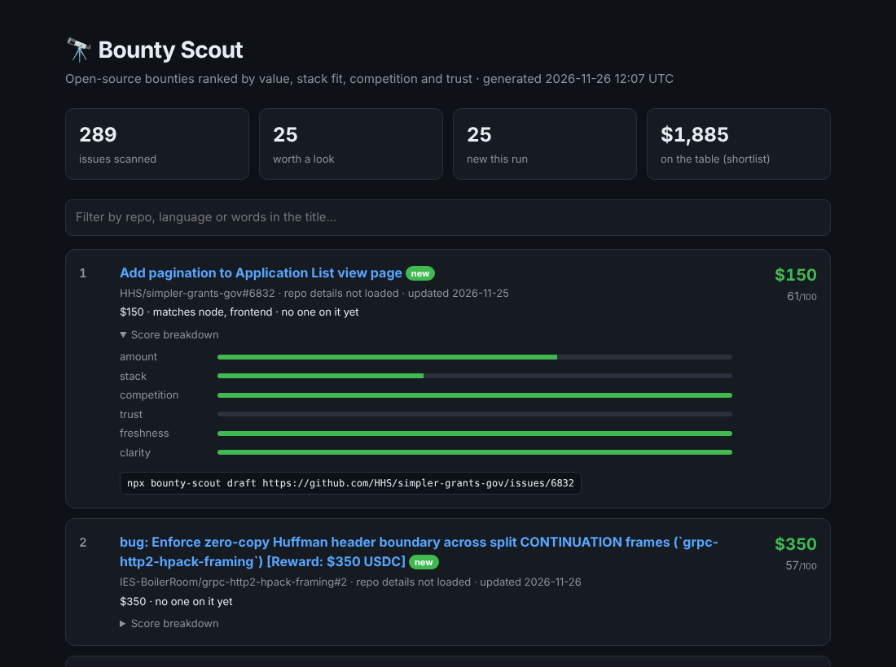

# 🔭 bounty-scout

**A human-in-the-loop agent that finds open-source bounties worth your time, ranks them, and drafts fixes for you to review.**

Paid bounties on GitHub (Algora, IssueHunt-style labels, maintainers posting “$200 bounty”) are a real way to earn from open source — but the feed is noisy. Many are already taken, assigned, crowded with `/attempt` comments, or posted by throw-away “bounty farm” repos. bounty-scout does the boring triage every week and hands you a short, honest list.



## What it does

1. **Scan** — searches GitHub for open bounty issues (`💎 Bounty` labels, `bounty` labels, `/bounty` commands) updated recently.
2. **Enrich** — loads repo metadata and the comment thread to find the real amount, who is already attempting it, and whether PRs have claimed it.
3. **Rank** — scores every bounty from 0 to 100 and explains why.
4. **Report** — writes a filterable HTML dashboard, a Markdown table and JSON. A GitHub Action publishes it to GitHub Pages every week and marks what's new.
5. **Draft (optional, local)** — clones the repo and runs [Claude Code](https://code.claude.com/docs) headless to prepare a minimal fix plus `BOUNTY_NOTES.md` (summary, how to verify, risks, honest completeness estimate). **It never pushes, opens PRs or comments.** You review, you decide, you submit.

## How bounties are ranked

| Signal | What it measures | Default weight |
|---|---|---:|
| Amount | Bounty value in USD, log-scaled ($2k+ = max) | 25 |
| Stack fit | Repo language and keywords from your config | 25 |
| Competition | `/attempt` comments and PR claims already on it | 20 |
| Trust | Stars, fork status, red flags | 15 |
| Freshness | Recent activity on the issue | 8 |
| Clarity | Description length, acceptance criteria, repro steps | 7 |

**Hard filters** drop bounties that are rewarded, on hold, assigned, below your minimum, on archived or tiny repos, or with too many people attempting.

**Red flags** don't hide a bounty but cut its score and show a warning:
- one small repo publishing many bounties at once (bounty farm)
- a repo that exists only to host bounties
- a large reward on a repo with almost no stars
- a repo created in the last 30 days
- keywords from your blocklist (e.g. “autonomous agents only”, “airdrop”)

The shortlist keeps at most two bounties per repo, so one noisy project can't fill it.

## Quick start

```bash
git clone https://github.com/<you>/bounty-scout && cd bounty-scout
npm install && npm run build && npm link

export GITHUB_TOKEN=ghp_...      # any token, no scopes needed; raises API limits
bounty-scout scan                # → out/index.html, out/report.md, out/bounties.json
bounty-scout scan --fast         # search only (3 API calls), rougher ranking
```

Tune it in [`bounty-scout.config.json`](bounty-scout.config.json): your languages and keywords, minimum amount and stars, the weights, and the red-flag keywords.

### Draft a fix

```bash
bounty-scout draft https://github.com/owner/repo/issues/123
# → out/drafts/owner__repo__123.patch
# → out/drafts/owner__repo__123.notes.md
```

Requires Claude Code installed and logged in. Then apply the patch in your own fork with `git apply`, run the project's tests, and only open a PR you understand and can defend.

## Safety model

- **No autonomous submissions.** Many maintainers rightly reject unreviewed AI PRs. The tool stops at a local patch.
- **No code execution by default.** The drafting agent can read and edit files but has no shell, so it never runs the code of a repository you don't know. `--shell` turns it on; use it inside a container or devcontainer.
- **Issue text is data, not instructions.** The prompt tells the agent to treat the issue and comments as a problem description, which limits prompt injection from hostile issues.
- **Read-only GitHub access.** The scanner only reads public data; the token needs no scopes.

## Run it every week

`.github/workflows/scout.yml` runs the scan every Thursday, remembers what it has already seen in `data/seen.json`, and publishes the report to GitHub Pages. To enable it: **Settings → Pages → Source: GitHub Actions**, then trigger the workflow once by hand.

Drafting stays local on purpose: it's the step that needs your judgement.

## What I learned building it

Searching GitHub for bounty labels returns hundreds of issues. In the first scan of 288 issues, 32 were already rewarded or assigned. The top of the raw list was dominated by a few repos posting dozens of identical “$780” bounties, crypto “bounty hunter” boards, and repos created only to host bounties. Without the trust signals and the per-repo cap, the shortlist was mostly noise. The ranking is the product.

## Roadmap

- [ ] Detect linked open PRs through the issue timeline API
- [ ] Learn weights from the bounties you actually pick and win
- [ ] Notifications (email / Telegram) for high-score new bounties
- [ ] Optional sandboxed drafting with `--shell` inside a Docker image

## Development

```bash
npm test          # vitest
npm run typecheck
```

MIT © Fabrizio Pino
